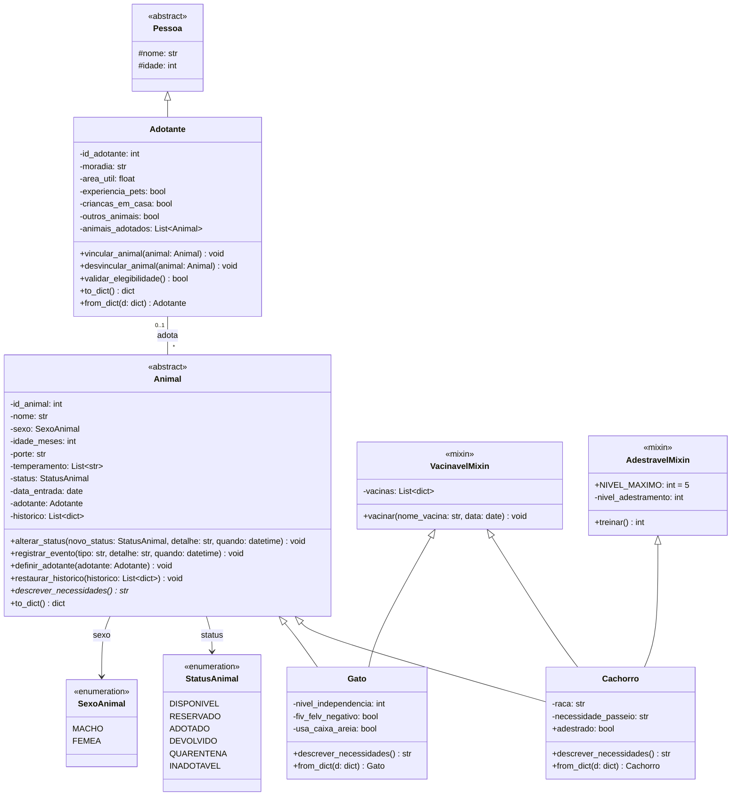
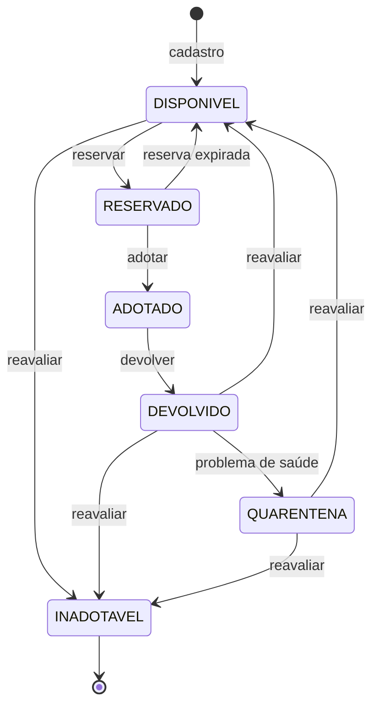

# Diagramas UML - Sistema de Adoção de Animais

## 1. Diagrama de classes - Domínio (`models/`)

## 2. Diagrama de classes - Serviços e infraestrutura

```mermaid
classDiagram
    class AdocaoService {
        -settings: Settings
        -animais: Dict~int, Animal~
        -adotantes: Dict~int, Adotante~
        -reservas: Dict~int, Reserva~
        -filas: Dict~int, FilaEspera~
        -observadores: List~Callable~
        +inscrever(observador: Callable) void
        +reservar(adotante: Adotante, animal: Animal, agora: datetime) Reserva
        +entrar_na_fila(adotante: Adotante, animal: Animal, agora: datetime) int
        +rodar_expiracao(agora: datetime) List~Animal~
        +adotar(adotante: Adotante, animal: Animal, agora: datetime) str
        +devolver(animal: Animal, motivo: str, problema_saude: bool, agora: datetime) void
        +reavaliar(animal: Animal, novo_status: StatusAnimal, agora: datetime) void
        +remover_animal(animal: Animal) void
        +exportar_estado() dict
        +importar_estado(dados: dict) void
    }

    class Reserva {
        <<dataclass>>
        +animal: Animal
        +adotante: Adotante
        +criada_em: datetime
        +expira_em: datetime
        +expirada(agora: datetime) bool
    }

    class FilaEspera {
        -entradas: List~EntradaFila~
        +adicionar(adotante: Adotante, pontuacao: float, quando: datetime) void
        +proximo() EntradaFila
    }

    class EntradaFila {
        <<dataclass>>
        +adotante: Adotante
        +pontuacao: float
        +entrada_em: datetime
    }

    class Settings {
        +idade_minima: int
        +area_minima_porte_g: float
        +reserva_horas: int
        +taxa_padrao: str
        +pesos: dict
        +carregar(caminho: str) Settings
    }

    class politicas {
        <<module>>
        +validar_politica(adotante, animal, settings) void
    }

    class compatibilidade {
        <<module>>
        +calcular_compatibilidade(adotante, animal, pesos) float
    }

    class relatorios {
        <<module>>
        +relatorio_disponiveis_adotados(animais) str
        +top_adotaveis(animais, adotantes, pesos, n) List
        +taxa_adocao_por(animais, chave) Dict
        +tempo_medio_adocao_dias(animais) float
        +devolucoes_por_motivo(animais) Dict
    }

    class BaseFeeStrategy {
        +VALOR_BASE: float = 100.0
        +calcular(animal: Animal) float
    }
    class SeniorFee {
        +calcular(animal: Animal) float
    }
    class PuppyFee {
        +calcular(animal: Animal) float
    }
    class SpecialCareFee {
        +calcular(animal: Animal) float
    }

    class RepositorioJSON {
        -pasta: Path
        +salvar(animais, adotantes) void
        +carregar() Tuple
        +salvar_estado(estado: dict) void
        +carregar_estado() dict
    }

    class ReservaInvalidaError { <<exception>> }
    class TransicaoDeEstadoInvalidaError { <<exception>> }
    class PoliticaNaoAtendidaError { <<exception>> }
    class RepositorioError { <<exception>> }

    %% Strategy de taxas
    BaseFeeStrategy <|-- SeniorFee
    BaseFeeStrategy <|-- PuppyFee
    BaseFeeStrategy <|-- SpecialCareFee

    %% Composição / associações
    AdocaoService o-- Settings
    AdocaoService "1" *-- "*" Reserva
    AdocaoService "1" *-- "*" FilaEspera
    FilaEspera "1" *-- "*" EntradaFila

    %% Dependências
    AdocaoService ..> politicas : valida
    AdocaoService ..> compatibilidade : pontua
    AdocaoService ..> BaseFeeStrategy : escolhe taxa
    AdocaoService ..> ReservaInvalidaError
    AdocaoService ..> TransicaoDeEstadoInvalidaError
    politicas ..> PoliticaNaoAtendidaError
    RepositorioJSON ..> RepositorioError
    relatorios ..> compatibilidade
```

> Cada `Reserva` e cada `EntradaFila` aponta para um `Adotante` (a reserva também para um `Animal`). `RepositorioJSON` persiste `Animal` e `Adotante`; o observer é um callback (`Callable[[str], None]`) inscrito no serviço.
>
> **Contrato de adoção:** não é uma classe. `AdocaoService.adotar()` devolve o texto do contrato (data, animal, adotante, taxa e termos).

## 3. Diagrama de estados - `StatusAnimal`

